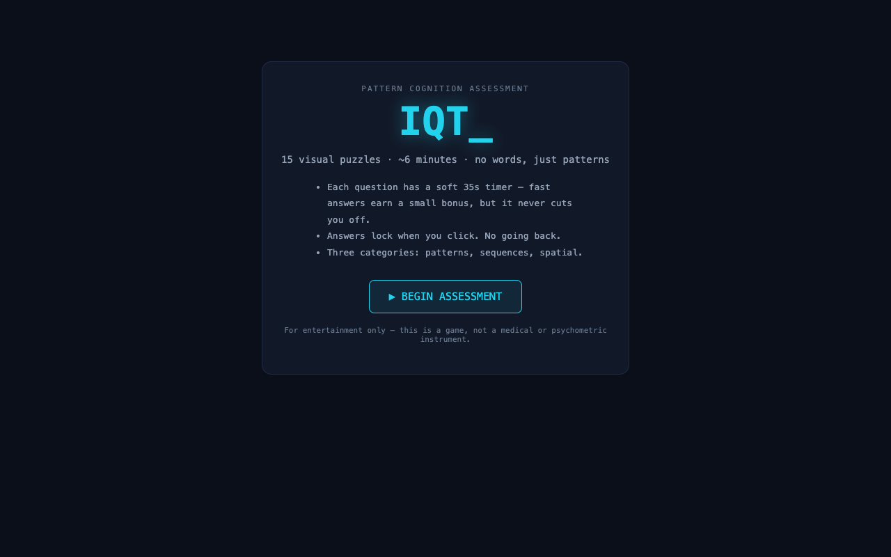
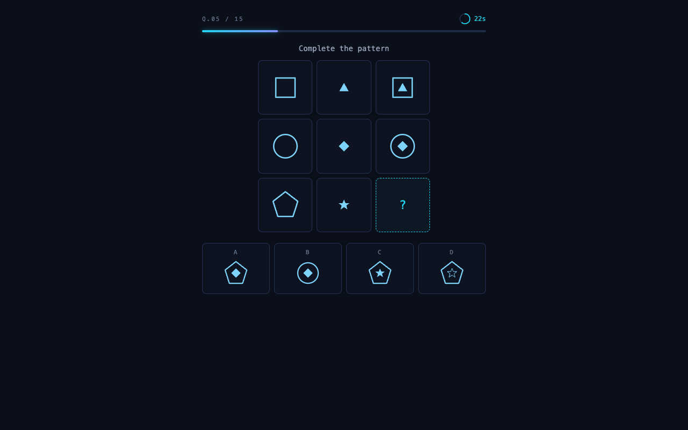
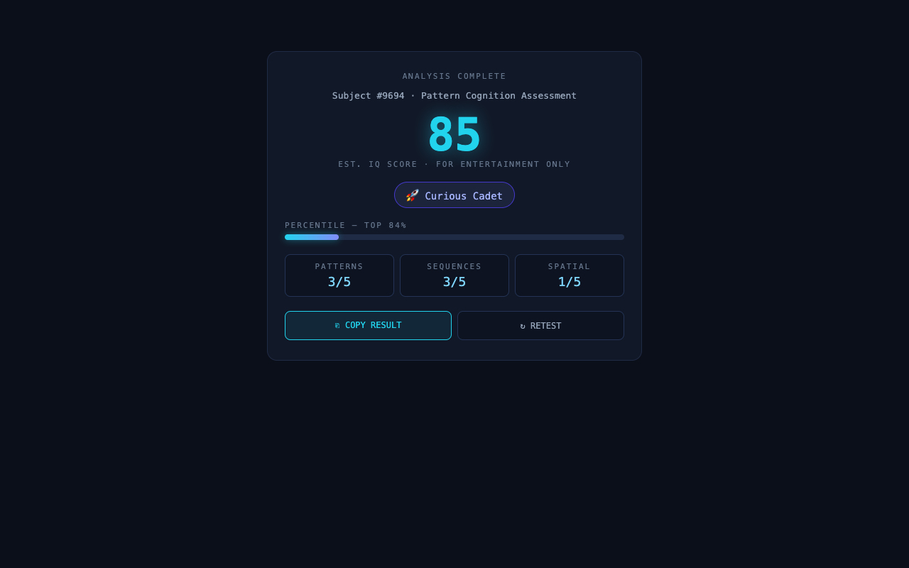

# IQT

IQT is a fun, fully client-side visual IQ test: 20 wordless pattern puzzles, a glowing terminal aesthetic, a soft timer with a speed bonus and a slow-answer penalty, and an IQ-style score with a playful title at the end. Everything runs in your browser — no accounts, no backend, nothing stored.

> **For entertainment only.** IQT is a game, not a medical or psychometric instrument. The score it produces is not a real IQ measurement and should not be treated as one.

**Live:** [https://iqt.moosha.org](https://iqt.moosha.org)



## How it works

- Each run draws **20 questions** from a hand-authored pool of **80 puzzles** (4 categories × 20: matrix **patterns**, **sequences**, **spatial** rotation/odd-one-out, and **analogies** A → B ∷ C → ?), each authored in four difficulty tiers (easy / medium / hard / expert).
- The per-run draw takes **1 easy, 1 medium, 1 hard, 2 expert** from every category and orders the test easy → expert, so each run is a fresh shuffle with a consistent difficulty curve and a guaranteed pair of really hard questions per category.
- Every question has a **soft 35-second timer**: it never cuts you off or blocks the answer. Answering within 30 seconds earns a speed bonus of up to **+0.5 points**; slower than 30 seconds costs a flat **−0.5 penalty** (right or wrong), and the timer ring turns red.
- Scoring: difficulty-weighted raw points → normalized against a **25% guessing floor** → shaped by a gentle **power curve (1.1)** → mapped to an IQ-style **70–145** scale, with a percentile from a normal(100, 15) distribution and a playful title band (e.g. "Curious Cadet").
- Results include a per-category breakdown and a **copy-to-clipboard share** card.





## Stack

- **Svelte 5 (runes) + TypeScript + Vite** — small, fast, no framework bloat.
- Puzzles are **declarative data specs** (shape, fill, rotation, decorations per cell) rendered by a small SVG glyph component — no images, everything is drawn at runtime.
- **Vitest** unit tests (19) cover scoring math (bonus, late penalty, IQ curve), question selection, share text, and pool validity (counts, unique answers, well-formed specs).
- **Zero backend** — fully client-side; nothing is sent or stored anywhere.

## Project layout

```
src/
  lib/
    types.ts            # core types: puzzle specs, categories, difficulty, results
    shapes.ts           # shape path constants used by the SVG renderer
    puzzles/
      patterns.ts       # 20 matrix-completion puzzles
      sequences.ts      # 20 what-comes-next sequences
      spatial.ts        # 20 rotation / odd-one-out puzzles
      analogies.ts      # 20 A → B ∷ C → ? analogies
      index.ts          # combined 80-puzzle pool
    selection.ts        # per-run draw: 1 easy / 1 medium / 1 hard / 2 expert per category
    scoring.ts          # weighted raw + bonus − late penalty → guessing floor → power curve → IQ scale
    share.ts            # clipboard share-card text
  components/
    Intro.svelte        # landing screen + disclaimer
    Test.svelte         # question flow, timing, answer locking
    TimerRing.svelte    # soft 35s countdown ring (red past the 30s penalty mark)
    PuzzleView.svelte   # grid/sequence/analogy layout + answer buttons
    GlyphSvg.svelte     # renders a declarative glyph spec as SVG
    Results.svelte      # score count-up, percentile, titles, share
    Gallery.svelte      # QA mode: all 80 puzzles with answers revealed
  App.svelte            # routing between intro / test / results / gallery
tests/                  # Vitest: scoring, selection, share, pool validity
Dockerfile              # nginx:alpine serving the built dist/
docker-compose.yml      # container bound to 127.0.0.1:8015
deploy.sh               # build + rsync + remote docker compose up
```

## Local development

```sh
npm install
npm run dev     # http://localhost:5173
npm test        # Vitest (19 tests)
npm run build   # production build to dist/
```

Gallery QA mode: open [http://localhost:5173/?gallery](http://localhost:5173/?gallery) to click through all 80 puzzles with the correct answers revealed — handy for sanity-checking new puzzle specs.

## Deployment

```
laptop: vite build ──rsync──▶ /opt/iqt on droplet ──▶ nginx:alpine @ 127.0.0.1:8015 ──▶ host Caddy (TLS) ──▶ https://iqt.moosha.org
```

`./deploy.sh` does everything: builds locally, rsyncs `dist/` + `Dockerfile` + `docker-compose.yml` to the server, runs `docker compose up -d --build`, and on first run appends the `iqt.moosha.org` vhost to the host Caddyfile (Caddy handles TLS certificates automatically).

Server prerequisites (already in place): Docker, Caddy, and SSH key access to the droplet.
